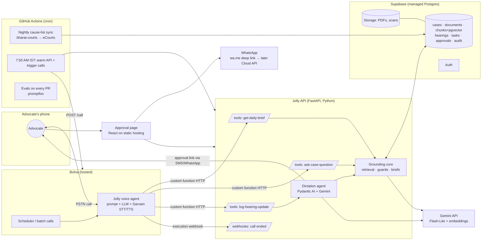
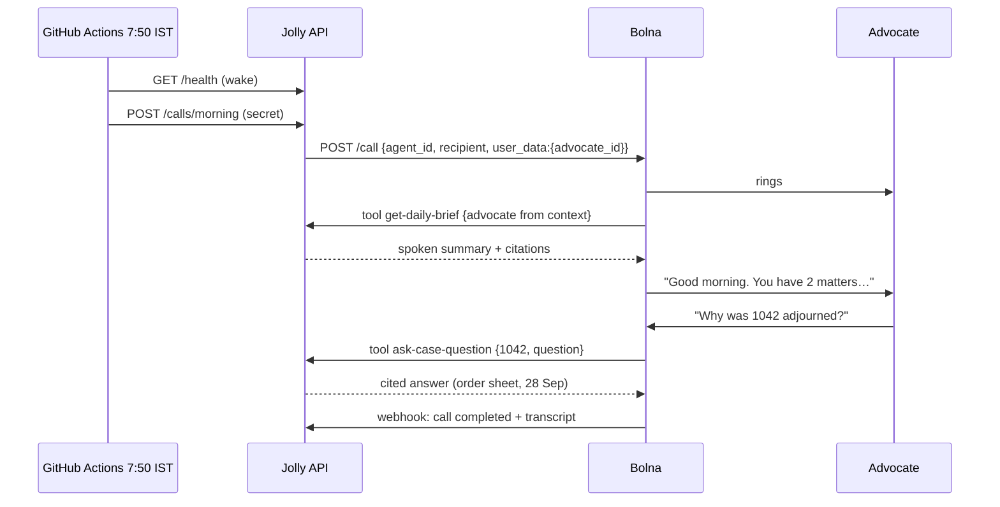
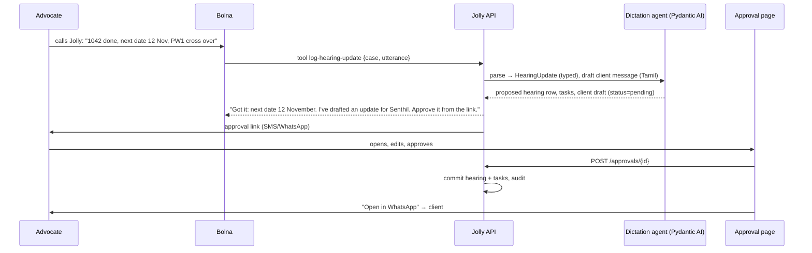

# Jolly Architecture

Status: **proposal for review** (Oct 19, 2026). Nothing in here is final until the founder signs off. Each decision has an ADR below with the options considered.

## 1. What Jolly is (scope this architecture serves)

Jolly is a **voice clerk for Indian litigation advocates**. There's no app to learn, just three phone moments and one approval tap:

| # | Moment | Who starts it | What happens |
|---|---|---|---|
| 1 | **8 AM brief** | Jolly calls the advocate | Today's listed matters: court hall, item number, purpose, what's pending. The advocate can interrupt with questions. |
| 2 | **Ask anytime** | Advocate calls Jolly | "Why was 1042 adjourned?" gets a short answer that cites the order sheet. "Will we win?" gets a polite refusal. |
| 3 | **Corridor callback** | Advocate calls or Jolly calls after the hearing | "1042 done, next date 12 November, PW1 cross completed" becomes a timeline entry, tasks and a drafted client update. |
| ✓ | **Approve** | Advocate taps a link | Approve or edit the update, then send it to the client on WhatsApp. Nothing leaves without approval. |

Out of scope for now: drafting pleadings, case-law research, recording inside the courtroom, judge-facing features and a full diary app.

## 2. Principles

1. **Wrap, don't rebuild.** Use managed services and open-source projects on free quotas, and write code only for Jolly's own logic: grounding, guards and the legal workflow.
2. **Voice is the product, Bolna is the voice.** Telephony, speech-to-text, text-to-speech, turn-taking and scheduling stay in Bolna. Jolly is the brain behind its tool calls.
3. **Every fact is traceable.** Answers cite document + paragraph/page. Jolly never generates case-law citations.
4. **Documents are data, never instructions.** Injection screening happens at ingestion, and untrusted text is attributed rather than stated as fact.
5. **Humans approve consequences.** Anything sent to a client, or any change to the diary from dictation, waits for approval.
6. **Degrade gracefully.** If the LLM quota runs out, Jolly falls back to deterministic, extractive answers, and the call still works.
7. **₹0 to demo, cheap to run.** Everything below fits free tiers at demo and pilot scale (≤10 advocates).

## 3. System overview



## 4. Component decisions (ADRs)

Each line: **choice** | options considered | why | free-tier limit that matters.

### ADR-1 Voice and telephony: **Bolna (hosted)**
- Options: Bolna hosted · Bolna self-hosted (MIT repo) · Pipecat · LiveKit Agents · Vapi/Retell.
- Why: the buildathon is Bolna's, it already integrates Sarvam (Tamil/Hindi STT/TTS), it calls our HTTP tools mid-conversation (OpenAI function-call schema + `custom_task`), it schedules outbound/batch calls, and it posts execution webhooks with transcripts. No telephony code for us.
- Limits: signup credit only (~$5). Each demo call spends it, so we should ask for buildathon credits. Bolna calls tools from fixed IPs (13.203.39.153, 13.126.9.249, 13.202.133.53), which we can allowlist.
- Fallback: Pipecat (BSD-2, Sarvam + Gemini Live built in) if Bolna credit or latency becomes a blocker.

### ADR-2 Who runs the conversation LLM vs. the legal brain
- **Bolna's agent LLM** handles turn-taking, small talk and deciding which tool to call.
- **Jolly's API** produces every legal fact, through deterministic briefs, cited retrieval and guarded answers. The voice LLM is instructed to read tool results, not to invent facts.
- Why: it keeps our Gemini quota for grounding, and it keeps the trust boundary in our code, where it's testable.

### ADR-3 LLM for grounding and dictation: **Gemini API, Flash-Lite on the free tier**
- Options: Gemini 3.8 Flash (free, **~20 requests/day per project**), Gemini Flash-Lite (free, **~500 requests/day**), Gemini 4 Argon (paid tier only), Groq/OpenRouter free models.
- Decision: **Flash-Lite for runtime**, Flash for the occasional harder dictation parse, with deterministic fallback everywhere. Quotas are per project, not per key, and reset at midnight Pacific (1:30 PM IST).
- Argon: use it from the founder's Gemini app subscription for **design and code review**, not at runtime.
- Model names live in env vars (`LLM_MODEL`, `LLM_MODEL_HARD`), so upgrading later is a config change.

### ADR-4 Database: **Supabase Postgres + pgvector** (vs. alternatives)
| Option | For | Against |
|---|---|---|
| **Supabase (chosen)** | Postgres + pgvector + Storage + Auth + pg_cron in one free project, Mumbai region, dashboard for the founder | Free projects pause after 7 days of low activity; 500 MB DB; 1 GB storage; 2 free projects |
| Neon | Serverless Postgres, branching, scale-to-zero | No storage/auth bundled; cold starts |
| Turso / SQLite | Zero ops, our current code | No managed file storage/auth; vector search is DIY |
| Firebase | Free tier, Google | Not relational; weak fit for legal records and joins |
- Why: one free service covers four needs. Daily 8 AM activity keeps it from pausing. 500 MB holds thousands of cases of text plus embeddings, and scans go to Storage.
- Migration: our SQLModel code already reads `DATABASE_URL`, so only the vector search moves from NumPy to pgvector (keep NumPy for SQLite/tests).

### ADR-5 API hosting: **Render free web service + pre-warm** (Cloud Run when a card is available)
| Option | For | Against |
|---|---|---|
| **Render free (chosen for now)** | Already configured (`render.yaml`), no card | Sleeps after 15 min idle; ~1 min cold start; 750 h/month |
| Google Cloud Run | 2M requests/month free, fast cold starts, Mumbai region | Needs a billing account (card) |
| Supabase Edge Functions | Same vendor, 500k invocations/month | Deno/TypeScript, which means rewriting the Python core |
| Hugging Face Spaces / Koyeb | Free containers | Sleep policies, less predictable |
- Cold-start mitigation: the 7:50 AM IST GitHub Action pings `/health` before triggering calls. Bolna's `pre_call_message` ("Let me check the file…") covers the gap when an inbound call wakes the API.
- The API stays a stateless container, so moving to Cloud Run later is a one-line deploy change.

### ADR-6 Scheduling: **GitHub Actions cron** (+ Bolna scheduling)
- Options: GitHub Actions schedule · Supabase pg_cron + pg_net · Bolna batch schedule (≤30 days ahead) · Cloud Scheduler.
- Decision: GitHub Actions for the nightly cause-list sync (Python, `bharat-courts`) and the 7:50 AM warm-up/call trigger, since it's free for public repos. Bolna batch scheduling is a backup for the morning call.
- Watch: GitHub cron can drift by a few minutes, which is fine for an 8 AM call.

### ADR-7 Court data: **bharat-courts** (MIT) with **openjustice-in/ecourts** as fallback
- Covers eCourts district courts, High Courts and the Supreme Court: case status, cause lists, order PDFs, with built-in CAPTCHA handling.
- It runs only in the nightly job, never in the call path. Results are upserted into `hearings` with `source='ecourts'`.
- Risk: young, single-maintainer project. We pin a version and keep our own adapter interface (`CourtDataSource`).
- Demo uses synthetic cases (current seed). Real sync is for pilot users only.

### ADR-8 Documents and OCR: **Supabase Storage + Docling + Tesseract (tam, hin)**
- Uploaded PDFs/photos go into Storage. An ingestion job extracts text (Docling; Tesseract for Tamil/Hindi scans), splits it into paragraph/page chunks with page numbers, screens it for injection, embeds it and stores it.
- Sarvam's document digitisation (₹0.50/page) is a paid upgrade for handwritten order sheets.

### ADR-9 Retrieval: **pgvector + Gemini embeddings**, keyword fallback
- `gemini-embedding` on the free tier (separate quota from generation). Postgres full-text (tsvector) runs as the lexical half of hybrid search. The offline hashing embedder is kept for tests/CI.
- Chunks carry `doc_id`, `page`, `para` and `trusted`/`suspicious` flags. Suspicious chunks are never retrieved.

### ADR-10 Agent framework: **Pydantic AI** for the dictation → approval flow
- Options: Pydantic AI · LangGraph · Google ADK · OpenAI Agents SDK · plain functions.
- Why: typed outputs (a `HearingUpdate` model), native Gemini support, and "deferred tools" that pause a run for human approval and resume it. That matches our consequential-action rule exactly. LangGraph only comes in if flows become long multi-step graphs.
- Q&A and briefs stay plain typed functions (already built). Not everything needs an agent.

### ADR-11 Approval UI and client messaging: **one React page + wa.me deep link → WhatsApp Cloud API later**
- The approval page (existing React/Vite app, deployed static) is opened from a signed, single-use link. The advocate edits or approves.
- MVP sending: an "Open in WhatsApp" button (`wa.me/<client>?text=…`) sends from the advocate's own WhatsApp, so it costs ₹0, needs no Meta approval, and the message comes from the advocate, which clients trust more.
- Later: WhatsApp Cloud API. Since Oct 1, 2026, service replies are free up to 1,000/month per number, and utility templates cost about ₹0.115 each. This needs Meta business verification.
- The approval link itself reaches the advocate in the call's closing line plus SMS/WhatsApp via Bolna's messaging, or simply a pinned dashboard bookmark for the pilot.

### ADR-12 Identity and auth
- Callers are identified by phone number (Bolna passes `from_number`/`to_number` into tool calls as context variables). Phone maps to advocate, and each tool call checks that the advocate owns the case.
- Tool endpoints are protected by a shared secret (`BOLNA_WEBHOOK_SECRET`) plus the IP allowlist.
- The approval page uses signed single-use tokens. Supabase Auth (Google/magic link) comes only when a multi-user dashboard is needed.

### ADR-13 Observability, audit, evals
- `audit_log` table: every tool call, answer (with citations), approval and send.
- Bolna execution webhooks store the transcript, cost and duration per call.
- Evals: a gold set of ~50 questions with known cited answers per demo case, plus dictation samples. promptfoo runs in GitHub Actions on every PR and reports **citation accuracy**, **refusal correctness** and **% dictations parsed without edits**. Those numbers go in the pitch deck.
- Optional: Langfuse Cloud free tier for LLM traces.

## 5. Data model (Postgres)

```mermaid
erDiagram
  ADVOCATE ||--o{ CASE : handles
  CASE ||--o{ DOCUMENT : has
  DOCUMENT ||--o{ CHUNK : split_into
  CASE ||--o{ HEARING : listed_on
  CASE ||--o{ TASK : needs
  CASE ||--o{ CLIENT_UPDATE : drafts
  CALL ||--o{ TOOL_CALL : made
  ADVOCATE ||--o{ CALL : receives
  CLIENT_UPDATE ||--|| APPROVAL : requires

  ADVOCATE { uuid id; text name; text phone_e164; text language; time brief_time }
  CASE { text id; text case_number; text court; text cnr; text stage; text client_name; text client_phone; text client_language }
  DOCUMENT { text id; text case_id; text kind; date doc_date; bool trusted; text storage_path }
  CHUNK { text id; text doc_id; int page; text para; text text; vector embedding; bool trusted; bool suspicious }
  HEARING { int id; text case_id; date date; text purpose; text outcome; date next_date; text source; text source_doc_id }
  TASK { int id; text case_id; text title; date due; text status }
  CLIENT_UPDATE { uuid id; text case_id; text language; text body; text status }
  APPROVAL { uuid id; uuid update_id; text decision; text edited_body; timestamptz decided_at }
  CALL { text execution_id; uuid advocate_id; text kind; text transcript; numeric cost }
  TOOL_CALL { int id; text execution_id; text tool; jsonb args; jsonb result; int ms }
```
`cnr` = eCourts CNR number, which links a case to the nightly sync.

## 6. Key flows

### 6.1 Morning brief call


### 6.2 Corridor callback → approval


## 7. Free-tier budget (pilot: 10 advocates, ~3 matters/day each)

| Service | Free allowance | Expected use/day | Headroom |
|---|---|---|---|
| Gemini Flash-Lite | ~500 req/day | ~60 (dictation + hard Q&A) | ✅ |
| Gemini Flash | ~20 req/day | ≤10 (fallback for hard parses) | ⚠️ tight, so fall back to Lite |
| Gemini embeddings | separate per-day quota | ingestion bursts | ✅ batch at night |
| Supabase | 500 MB DB, 1 GB storage | text + vectors ≪ 100 MB | ✅ (scans fill storage first) |
| Render | 750 h/month, sleeps | 1 service | ✅ with warm-up |
| GitHub Actions | free for public repos | 2 cron jobs + CI | ✅ |
| Bolna | signup credit | ~2 calls × 3 min × 10 | ❌ **the real cost.** Needs buildathon credits or a paid plan |
| WhatsApp | wa.me free | n/a | ✅ |

**The only real cost is call minutes.** That's also the business model: charge advocates ₹499–999/month, well above per-minute cost.

## 8. What we keep from the current code
- `backend/services/cases.py` (spoken case-number matching, deterministic briefs) and `backend/api/bolna.py` tool endpoints: **keep**.
- `backend/services/{ingest,retrieval,guard,qa}.py` (PR #4): **keep**. The retrieval backend gets a pgvector implementation behind the same `search()` interface.
- SQLModel models: **keep**, extended with `advocate`, `client_update`, `approval`, `call`, `tool_call`, `audit_log`.
- New code is limited to: the Pydantic AI dictation agent, the `log-hearing-update` tool, the approval endpoints + page, the `CourtDataSource` adapter over bharat-courts, and the GitHub Actions workflows.

## 9. Build order (each step is a small PR, reviewed before the next)
1. **Accounts & config**: Gemini key, Bolna account, Supabase project (after this doc is approved). Secrets live in Render/GitHub, never in the repo.
2. **Bolna agent v1**: prompt + two existing tools (`get-daily-brief`, `ask-case-question`) on the synthetic seed. The first real phone call.
3. **Supabase migration**: `DATABASE_URL` → Supabase, pgvector search, Storage for documents.
4. **Dictation → approval**: Pydantic AI agent, `log-hearing-update`, approval page, wa.me send.
5. **Morning scheduler**: GitHub Actions warm-up + `POST /call`.
6. **Evals in CI**: gold set + promptfoo, with the accuracy number in the README.
7. **Real court data (pilot)**: bharat-courts nightly sync for one Chennai court.
8. **Tamil/Hindi polish**: Sarvam voices in Bolna, Tamil client drafts.

## 10. Open questions for the founder
1. Do you have a card for a Google Cloud billing account? If yes, Cloud Run instead of Render (no cold starts, still free at our scale).
2. Is the repo public (needed for free GitHub Actions minutes at this volume)?
3. For the pilot, will the advocate approve from a web link, or should approval happen by voice ("send it") with the link only for edits?
4. Bolna credits: should we ask the buildathon team for extra credit now?

## 11. Risks
| Risk | Mitigation |
|---|---|
| Gemini free quotas shrink again | Deterministic fallback, Flash-Lite default, env-driven model swap |
| Render cold start during an inbound call | Pre-warm, `pre_call_message`, move to Cloud Run |
| Supabase pauses | Daily activity from the 8 AM job; restore within 1 year |
| eCourts layout changes break the sync | Nightly-only, adapter interface, fallback library, synthetic data for demo |
| Bolna credit runs out mid-demo | Record a backup demo video; request credits early |
| Hallucinated legal facts | Citation validation, refusal guard, evals in CI, approval before anything is sent |
| Prompt injection via documents | Screen at ingestion, never retrieve flagged chunks, attribute untrusted text |
