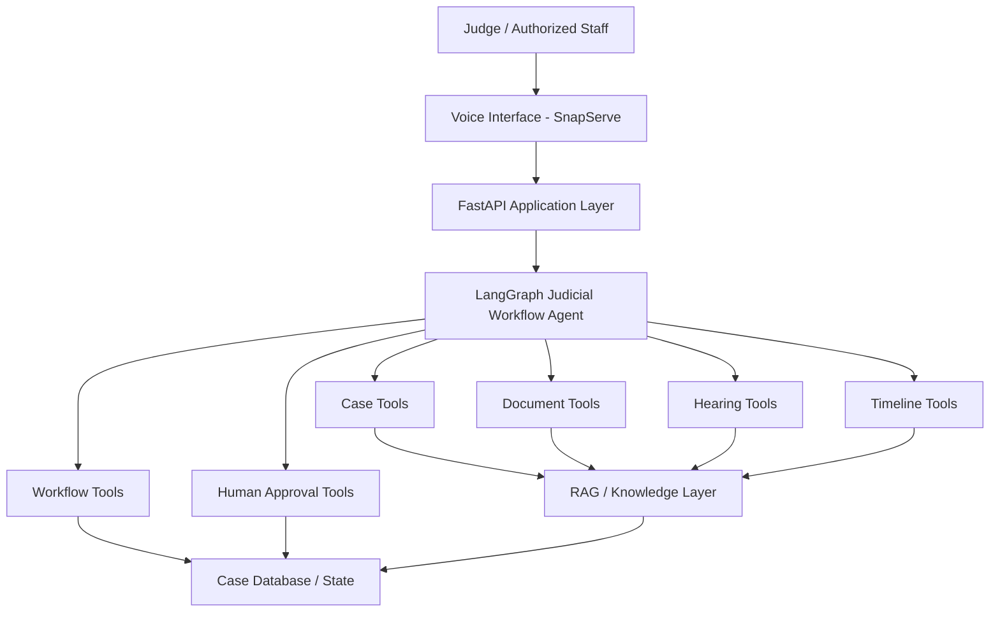
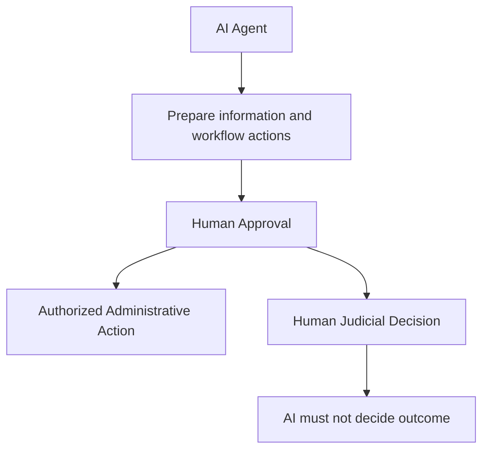
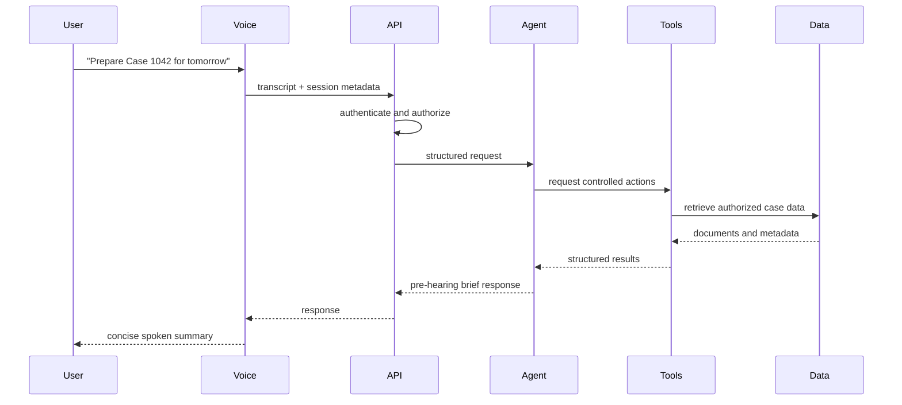
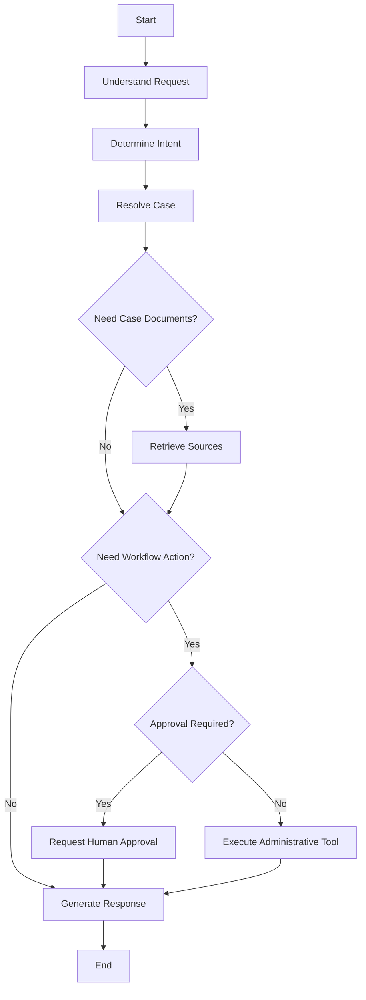
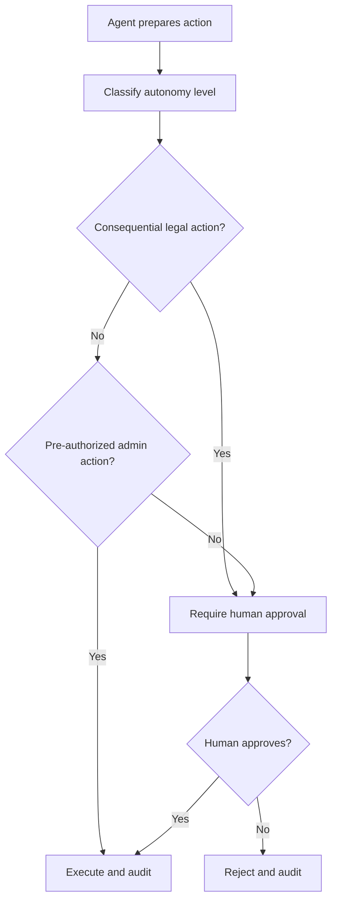

# AIRA Technical Documentation

## Repository State

Current implementation inspected:

- Backend framework: FastAPI in `server.py`.
- Frontend framework: no frontend framework; `GET /` returns inline HTML and JavaScript.
- Package management: `uv` with `pyproject.toml` and `uv.lock`.
- Python version: `>=3.12`.
- Docker: `python:3.12-slim`, installs `uv`, runs `uvicorn server:app`.
- Existing API: `POST /call` starts a SnapServe outbound call.
- Existing voice provider: SnapServe outbound call API.
- Existing AI integrations: none.
- Existing RAG implementation: none.
- Existing database: none.
- Existing environment variable: `SNAPSERVE_API_KEY`.
- Existing deployment target: Render, based on project context.

## System Architecture

Planned target architecture:



Judicial authority boundary:



## Component Architecture

Voice layer:

- SnapServe handles telephony, speech-to-text, and text-to-speech where supported.
- It should pass transcript or intent data to FastAPI.
- It must not contain judicial logic.

Application layer:

- FastAPI validates requests, authenticates users, checks authorization, manages sessions, invokes the agent, and returns structured responses.
- It owns side-effect boundaries and error handling.

Agent layer:

- LangGraph should orchestrate explicit workflow states.
- The first implementation should use one agent, not multi-agent orchestration.
- The agent reasons about which controlled tools to request.

Intelligence layer:

- LLM for language understanding, planning, extraction assistance, and response generation.
- RAG for source-grounded case knowledge.
- Tools for controlled case, document, hearing, timeline, workflow, and approval operations.

Data/state layer:

- PostgreSQL/Supabase for structured case, hearing, workflow, and audit state.
- Object storage for uploaded source documents.
- Vector storage for searchable document chunks.

## Request Lifecycle



## Voice Lifecycle

1. User speaks through a phone call.
2. SnapServe captures speech and produces text/transcript.
3. FastAPI receives the request.
4. The agent prepares a response.
5. FastAPI returns structured response text.
6. SnapServe speaks the response.
7. User can ask follow-up questions or request approved workflow actions.

## Agent Lifecycle



## Document Lifecycle

```text
Upload
-> Validate
-> Malware/file checks
-> Parse
-> OCR if required
-> Classify
-> Extract metadata
-> Store source document
-> Store structured metadata
-> Chunk
-> Embed
-> Index
-> Retrieve
-> Cite
-> Use in workflow
```

Document provenance should include source, upload actor, timestamp, version, checksum, case ID, document type, extraction confidence, and citation anchors.

Planned document types:

- petition
- complaint
- affidavit
- counter petition
- notice
- evidence
- previous order
- hearing record
- supporting annexures
- judgments
- procedural documents

## RAG Lifecycle

1. Select authorized case scope.
2. Retrieve candidate documents by metadata and keyword search.
3. Retrieve relevant chunks by semantic search.
4. Optionally rerank results for the MVP if baseline retrieval is weak.
5. Return source chunks with document IDs and citation anchors.
6. Generate only source-grounded factual statements.
7. Mark uncertainty when evidence is incomplete.

Retrieval isolation is mandatory: case data from one case must not leak into another case.

## Case Lifecycle

Planned case states for MVP:

- created
- documents pending
- ready for hearing preparation
- hearing scheduled
- hearing prepared
- hearing completed
- follow-up pending
- follow-up completed

These are administrative workflow states, not judicial outcomes.

## Hearing Lifecycle

```text
Hearing scheduled
-> Pre-hearing preparation requested
-> Brief generated
-> Judge reviews
-> Hearing occurs
-> Human decision or direction recorded
-> Follow-up workflow prepared
-> Approved administrative actions executed
```

## Postponement Lifecycle

Postponement event fields:

- hearing_id
- case_id
- date
- reason if available
- source document or hearing record
- responsible category if available
- missing documents involved
- next date if available
- confidence

Postponement intelligence is administrative only. It must not recommend a legal outcome.

## Human Approval Lifecycle



## Tool Architecture

Tool principles:

- Strict input schemas.
- Application-level validation.
- Authorization checks before execution.
- Structured success and error outputs.
- Idempotency keys for state-changing operations.
- Audit logs for every tool call.
- No direct LLM access to SQL, secrets, shell, or filesystem.

Planned tool groups:

- Case tools: `get_case`, `search_cases`, `get_case_status`, `update_case_status`.
- Document tools: `search_documents`, `retrieve_document`, `classify_document`, `extract_document_metadata`, `find_missing_documents`.
- Proceeding tools: `get_hearing_history`, `get_next_hearing`, `get_postponements`, `create_hearing`, `update_hearing`.
- Timeline tools: `build_case_timeline`, `get_events`.
- Workflow tools: `create_task`, `list_tasks`, `complete_task`, `create_notification`.
- Knowledge tools: `semantic_search`, `keyword_search`, `retrieve_source`, `citation_lookup`.
- Generation tools: `generate_case_summary`, `generate_pre_hearing_brief`, `generate_draft_document`.
- Human approval tools: `request_approval`, `record_approval`, `reject_action`.

## Data Flow

```text
Case source documents
  -> object storage
  -> parser/OCR
  -> metadata extraction
  -> relational database
  -> chunking/embedding
  -> vector index
  -> retrieval
  -> agent brief generation
  -> human review
  -> audited administrative follow-up
```

## Security Boundaries

- Frontend never receives secrets.
- LLM never directly executes side effects.
- Uploaded documents are untrusted data.
- Case access must be checked before retrieval.
- Retrieved context must be scoped to authorized case IDs.
- Human approval is required for consequential actions.
- Audit logs must record approvals and executed actions.

## Threat Model

| Threat | Mitigation |
| --- | --- |
| Prompt injection in legal documents | Treat document text as untrusted data; separate system instructions from retrieved content; ignore instructions inside documents. |
| Malicious uploaded files | Validate file type, size, and content; scan files before parsing; isolate parsing workers where possible. |
| Unauthorized case access | Authenticate users, enforce RBAC, check case-level permissions on every request. |
| Data leakage between cases | Filter retrieval by case ID and authorized scope; test cross-case isolation. |
| Hallucinated legal information | Require citations for factual claims; mark unsupported claims as unavailable. |
| Unsupported summaries | Generate summaries only from retrieved source chunks; include source references. |
| Incorrect extraction | Store extraction confidence; allow human correction; keep source links. |
| Incorrect dates | Normalize dates with source references; surface ambiguity. |
| Unauthorized workflow execution | Use approval gates and tool authorization checks. |
| Model manipulation | Keep tools permissioned; validate all tool calls in application code. |
| Credential leakage | Store secrets in environment/platform secrets; never expose secrets to frontend or logs. |
| Malicious tool invocation | Validate schemas, roles, permissions, and idempotency before execution. |

## Deployment Architecture

Current:

```text
Render
  -> Docker container
  -> FastAPI app
  -> SnapServe outbound call API
```

Planned:

```text
Render web service
  -> FastAPI application
  -> LangGraph agent runtime
  -> managed PostgreSQL/Supabase
  -> object storage
  -> vector storage
  -> LLM and embedding provider
  -> logging/observability service
```

## Local Development Architecture

Current:

```text
uv sync
uv run uvicorn server:app --reload
```

Required current environment variable:

```text
SNAPSERVE_API_KEY
```

Future local development should use fixture case data before connecting to real court data.

## Observability Strategy

Planned trace fields:

- request_id
- session_id
- user_id
- case_id
- agent_version
- model
- latency
- token usage
- tool calls
- retrieved documents
- citations
- approval status
- errors
- final result

## Failure Modes

- Missing case: ask for clarification.
- Unauthorized access: deny and audit.
- Missing source documents: report as unresolved administrative issue.
- Retrieval failure: do not fabricate a brief.
- Low-confidence extraction: mark uncertainty.
- Tool failure: return structured error and preserve state.
- Voice failure: allow UI/API fallback.
- Approval rejection: do not execute action; record rejection.

## Excalidraw Diagram Specification

An Excalidraw MCP/server is not available in this environment. To create `/docs/architecture.excalidraw` later, use a small diagram with these elements:

```text
USER / JUDGE
      |
      v
VOICE INTERFACE
      |
      v
AI JUDICIAL AGENT
      |
      +----------------+
      |       |        |
      v       v        v
DOCUMENT   CASE     HEARING
TOOLS      TOOLS    TOOLS
      |       |        |
      +-------+--------+
              |
              v
       RAG / KNOWLEDGE
              |
              v
        CASE DATABASE

AI AGENT
    |
    v
HUMAN APPROVAL
    |
    v
AUTHORIZED ACTION
```

Visually distinguish AI-controlled workflow from human-controlled judicial decision. Keep the diagram small enough for one screen.
